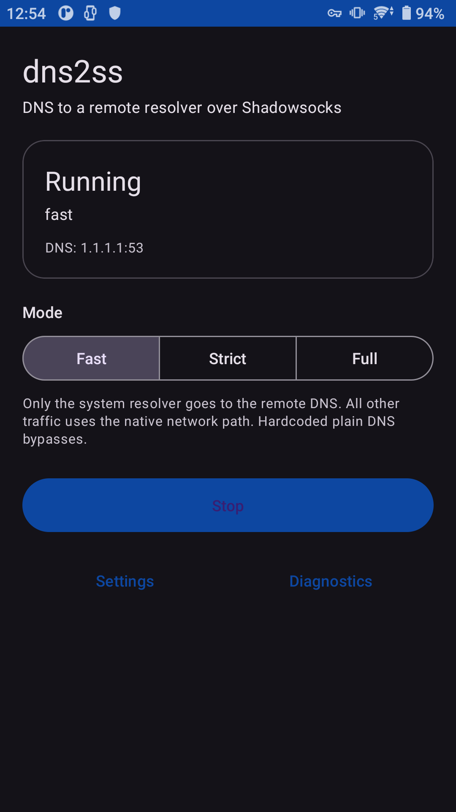
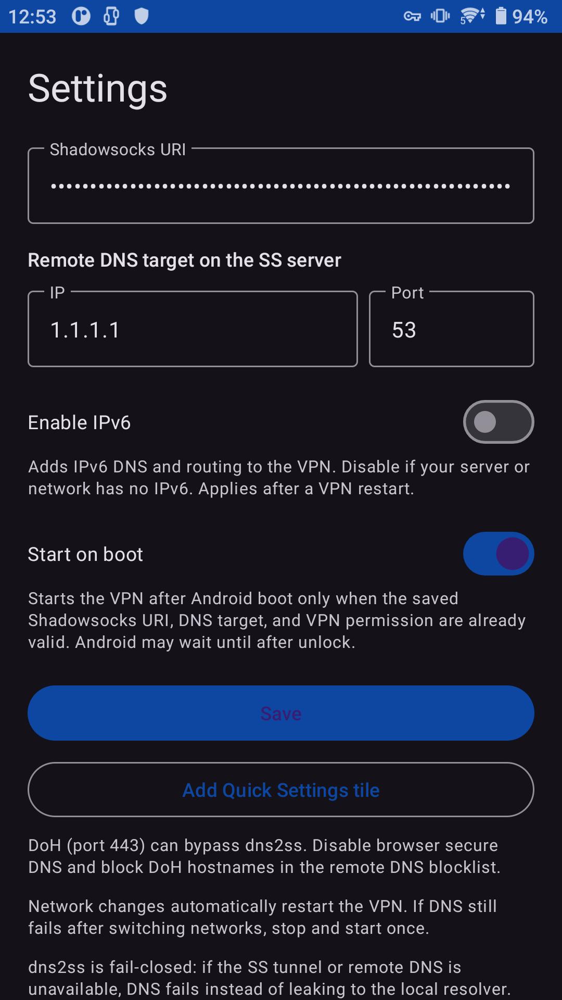
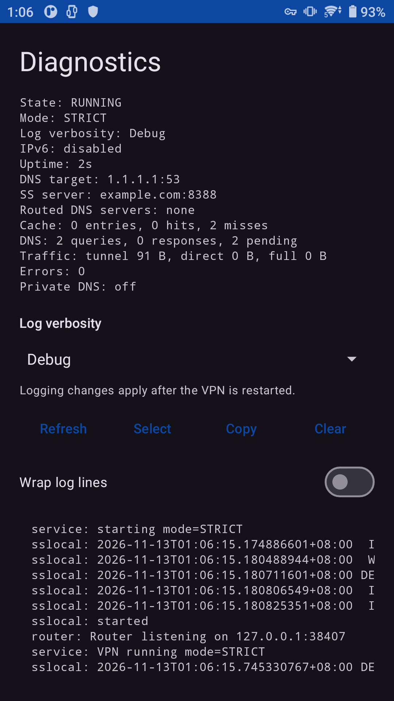

# dns2ss

A focused Android VPN that sends DNS queries to a remote resolver through a Shadowsocks server.

<p align="center">
  
  
  
</p>

## What it does

- Routes DNS to a remote resolver over Shadowsocks; no fallback to the local resolver.
- Offers three levels of non-DNS handling, from DNS-only to full-device proxying.
- Has no account, analytics, crash reporting, or remote configuration.

## Modes

| Mode | DNS | Non-DNS traffic | Notes |
|---|---|---|---|
| **Fast** | System resolver → remote DNS over SS | Native/kernel direct | Lowest overhead; hardcoded plain DNS to other servers bypasses |
| **Strict** | Every TCP/UDP port 53 → remote DNS over SS | Direct through a userspace router | Catches hardcoded plain DNS; no DoH/DoT coverage |
| **Full** | Every TCP/UDP port 53 → remote DNS over SS | Through Shadowsocks via a local SOCKS upstream | All app traffic goes through SS; local LAN resources are not directly reachable |

## Architecture

```text
VpnService TUN
  └─ hev-socks5-tunnel (socks5.pipeline enabled)
       └─ local SOCKS5 router (random port, random credentials)
            ├─ port 53 (TCP/UDP)
            │    ├─ shared DNS tunnel socket
            │    ├─ TTL-aware DNS cache
            │    └─ sslocal tunnel local → SS server → remote DNS
            └─ other ports
                 ├─ Fast: not routed into the TUN
                 ├─ Strict: direct socket
                 └─ Full: sslocal SOCKS local → SS server
```

The app excludes itself from the VPN, supports IPv4 and optional IPv6, and restarts the tunnel when the underlying network changes. See [Architecture](docs/ARCHITECTURE.md) for components, cache behavior, exclusions, and limitations.

## Requirements

- Android 10+ (`minSdk 29`), `arm64-v8a` or `x86_64`.
- A Shadowsocks server using AEAD or AEAD-2022 with UDP relay enabled.
- A remote DNS resolver reachable from that server, listening on TCP and UDP.
- Private DNS disabled; browser/application DoH disabled or blocked.
- JDK 17 and Android SDK platform/build-tools 35 for building.

## Build

```powershell
$env:JAVA_HOME = '<path-to-jdk-17>'
$env:ANDROID_SDK_ROOT = '<path-to-android-sdk>'
.\gradlew.bat :app:assembleDebug
```

The APK is written to `app/build/outputs/apk/debug/app-debug.apk`. Release signing is documented in [Release](docs/RELEASE.md).

## Usage

1. Open **Settings** and enter a Shadowsocks URI (`ss://...`) and the remote DNS target.
2. Choose Fast, Strict, or Full on the landing page.
3. Press **Start** and grant VPN permission.
4. Use the Quick Settings tile after the first successful start.
5. Optionally enable **Start on boot** in Settings. It starts after boot only when the config is valid and VPN permission was already granted.

## Documentation

- [Architecture](docs/ARCHITECTURE.md) — components, modes, DNS pipeline, network changes, limitations.
- [Testing](docs/TESTING.md) — automated checks, test client, local test DNS server, benchmarks.
- [Release](docs/RELEASE.md) — signed builds, CI, compatibility, release checklist.
- [Contributing](CONTRIBUTING.md) — commit discipline, style, security expectations.

## Limitations

- Private DNS/DoT and DoH bypass port 53; disable them or block DoH hosts in the remote resolver.
- Fast mode deliberately does not capture plain DNS sent directly to arbitrary servers.
- Apps that bind sockets to the underlying network bypass the VPN.
- IPv6 is optional and is not tunneled when disabled.
- The app does not provide per-app routing, always-on/lockdown, or 32-bit ABIs.

See [Architecture](docs/ARCHITECTURE.md#limitations-and-operational-notes) for the full list.

## Third-party components

Uses [hev-socks5-tunnel](https://github.com/heiher/hev-socks5-tunnel) and the official [shadowsocks-rust](https://github.com/shadowsocks/shadowsocks-rust) `sslocal` binary, plus AndroidX and Material Components. See [THIRD_PARTY_NOTICES.md](THIRD_PARTY_NOTICES.md) and [third_party/licenses/](third_party/licenses/).

## License

MIT. See [LICENSE](LICENSE).
